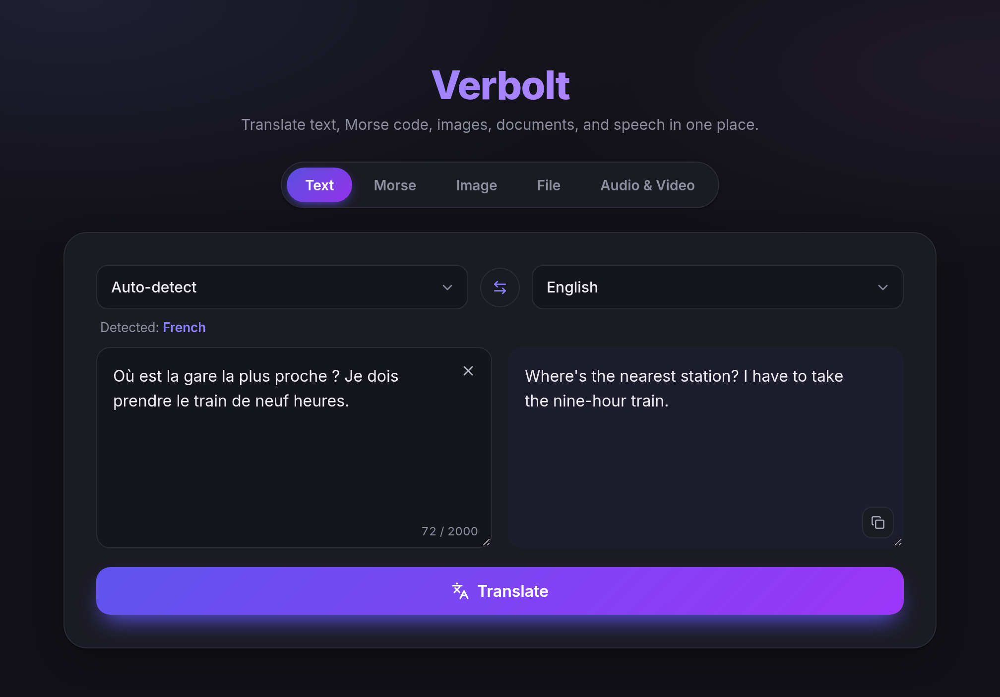
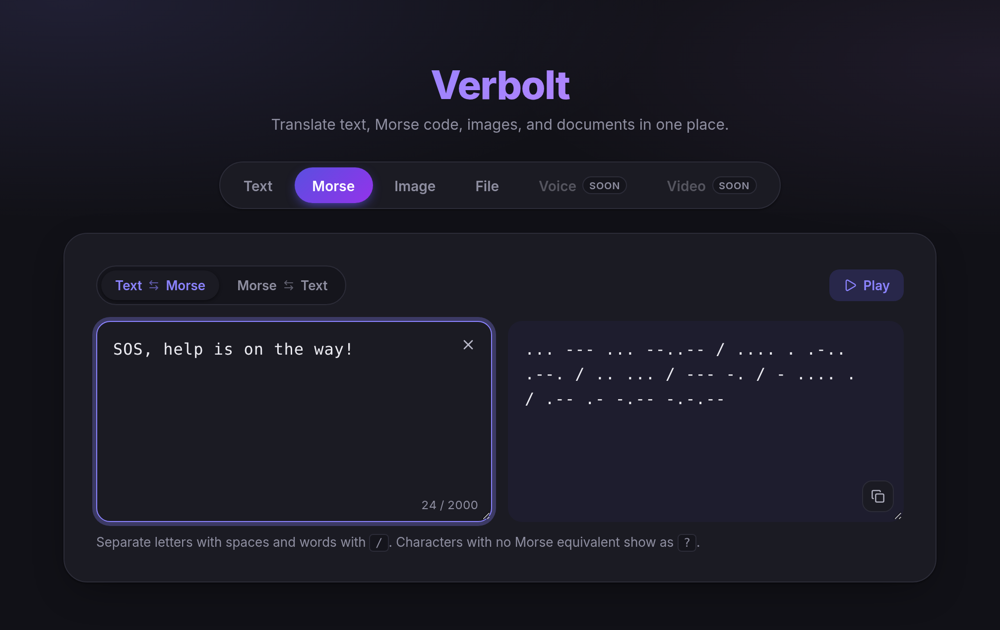
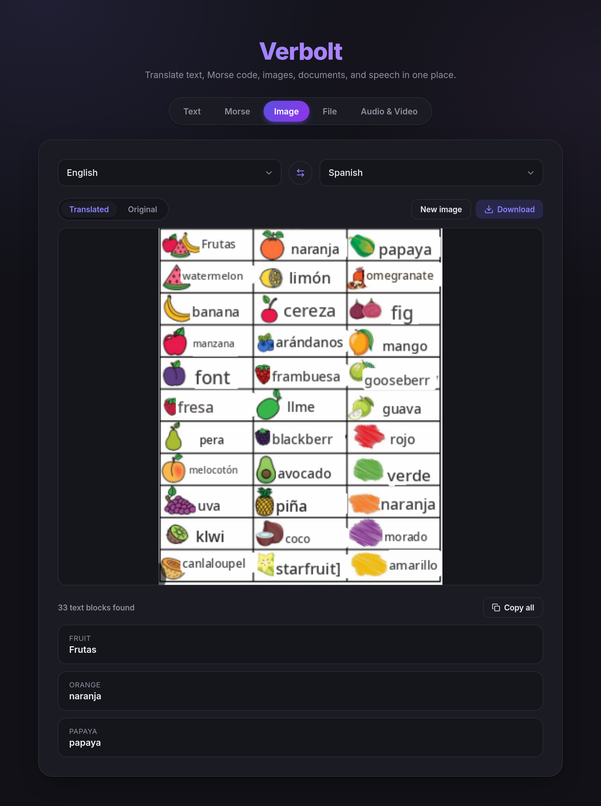
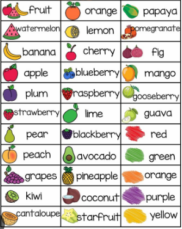
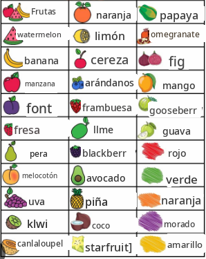
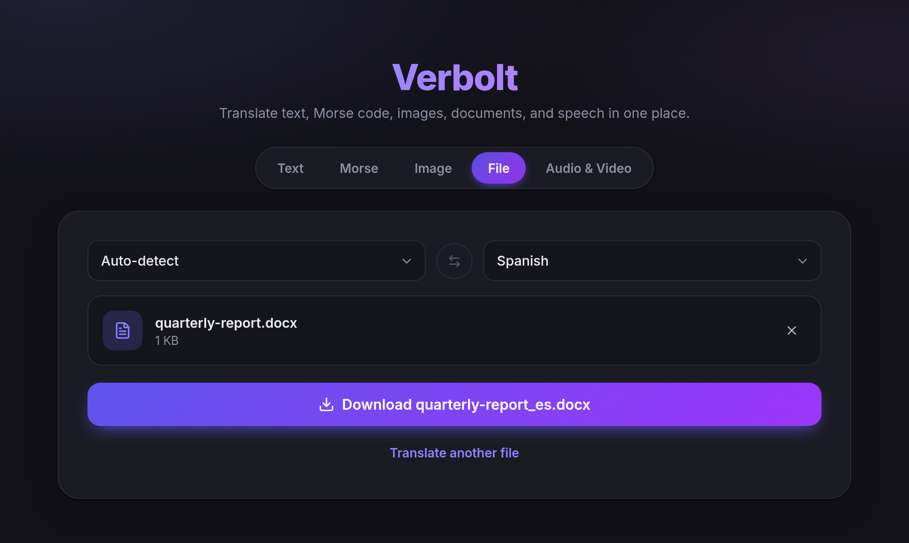

# Verbolt

A full-stack translation web app for text, Morse code, images, and documents. Type or paste text, snap a photo of a sign, or drop in a Word or PDF file, and get it back in another language. Images are redrawn with the translation in place, and documents come back in the same format with their formatting kept. Translation runs on a self-hosted LibreTranslate server, so there are no API keys or rate limits.



## Features

### Text

- Translate between any languages your LibreTranslate server has installed
- Auto-detect the source language, with the detected language shown under the selector
- Swap languages and text in one click to translate the result back
- Translate with Ctrl/Cmd+Enter, copy the result with one click

### Morse code

- Converts live as you type, no button needed
- Switch between Text → Morse and Morse → Text; the current result carries over
- Play the code back as audio with standard Morse timing
- Supports letters, numbers, and punctuation, and accepts look-alike characters like `•` and `—` when decoding

### Images

- Text is read with OCR (English, Spanish, French, German, Italian, Portuguese, Japanese, Chinese, Korean), translated, and redrawn in the original position and color
- Drop, pick, or paste a screenshot with Ctrl/Cmd+V
- Flip between the translated and original image, download the result, and copy all detected text

### Documents

- Upload a document and download the same file translated, with its formatting kept
- Supports Word (.docx), PowerPoint (.pptx), PDF, plain text, OpenDocument (.odt, .odp), EPUB, HTML, and subtitles (.srt), up to 20 MB

### Everywhere

- Light and dark mode that follows your system
- Remembers your mode, languages, and theme between visits
- Clear error messages, including a banner with a retry button when the translation server is down

## Showcase

### Morse code



### Image translation



English to Spanish:

| Original | Translated |
| --- | --- |
|  |  |

### Document translation



## Roadmap

- Voice translation
- Video translation
- Support for sign language

## Tech Stack

**Frontend:** React, TypeScript, Vite, Axios, react-dropzone, Lucide icons
**Backend:** Python, FastAPI, LibreTranslate, EasyOCR, OpenCV, Pillow

## Getting Started

You need three things running: the LibreTranslate server, the backend, and the frontend.

### Translation server

Verbolt translates with a self-hosted [LibreTranslate](https://github.com/LibreTranslate/LibreTranslate) server. Install it in its own virtualenv so its dependencies don't clash with EasyOCR's:

```bash
python -m venv ~/.venvs/libretranslate
~/.venvs/libretranslate/bin/pip install libretranslate
~/.venvs/libretranslate/bin/libretranslate --load-only en,es,fr,de,it,pt,ja,ko,zh-Hans --port 5000
```

The first start downloads the language models (about 2 GB), which takes a few minutes. Later starts are quick. Drop `--load-only` to get every language LibreTranslate supports.

### Backend

```bash
cd backend
python -m venv venv
source venv/bin/activate   # Windows: venv\Scripts\activate
pip install -r requirements.txt
uvicorn main:app --reload
```

The API runs at `http://localhost:8000`. OCR models and fonts for image translation download the first time each language is used, so that first request is slow.

### Frontend

```bash
cd frontend
npm install
npm run dev
```

Open the URL Vite prints (usually `http://localhost:5173`). If the app shows "Translation is unavailable", check that the LibreTranslate server is running.

### Configuration

| Variable | Where | Default |
| --- | --- | --- |
| `LIBRETRANSLATE_URL` | backend | `http://localhost:5000` |
| `LIBRETRANSLATE_API_KEY` | backend | none |
| `ALLOWED_ORIGINS` | backend, comma-separated frontend origins | any `localhost` port |
| `VITE_API_URL` | frontend (`frontend/.env`) | `http://localhost:8000` |

## API

| Endpoint | Description |
| --- | --- |
| `GET /languages` | Languages available on the LibreTranslate server |
| `POST /translate` | Translate text (JSON: `text`, `source_language`, `target_language`); returns the translation and the detected language when the source is `auto` |
| `POST /translate-image` | Translate the text in an image (form data: `file`, `source_language`, `target_language`); returns each text block and the redrawn image |
| `POST /translate-file` | Translate a document (form data: `file`, `source_language`, `target_language`); returns the translated file |
